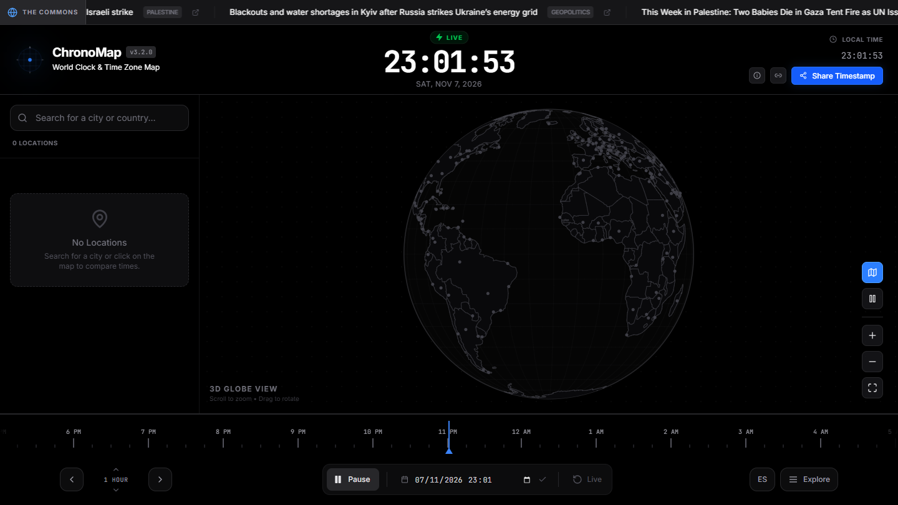
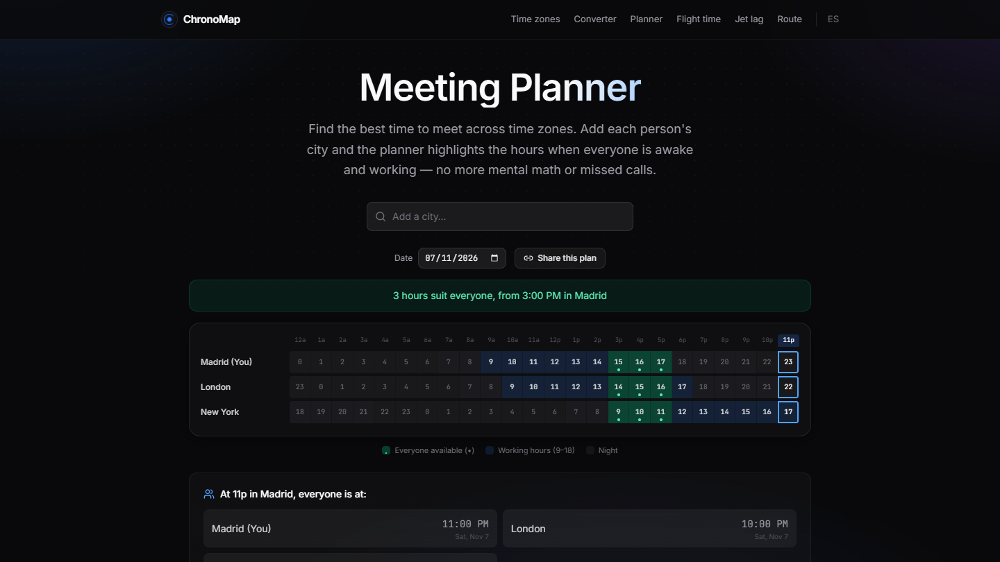
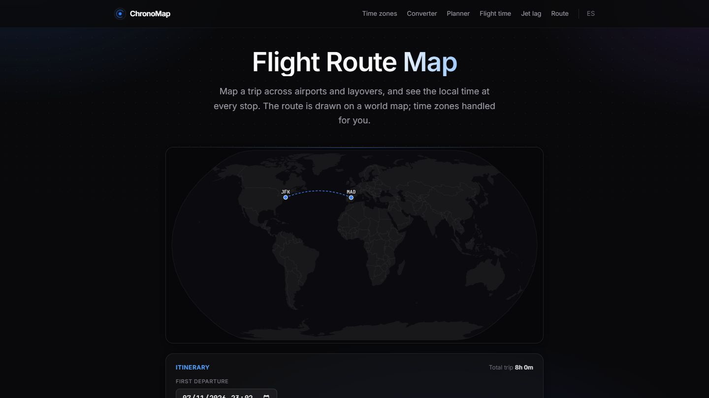
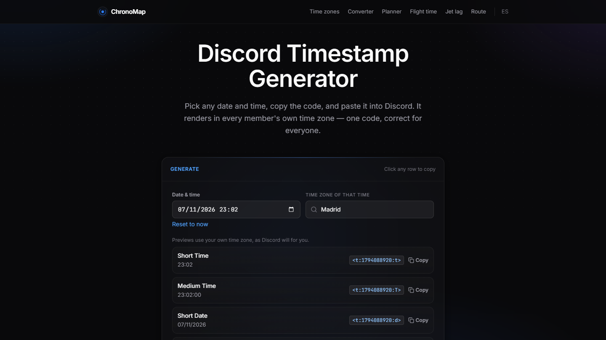
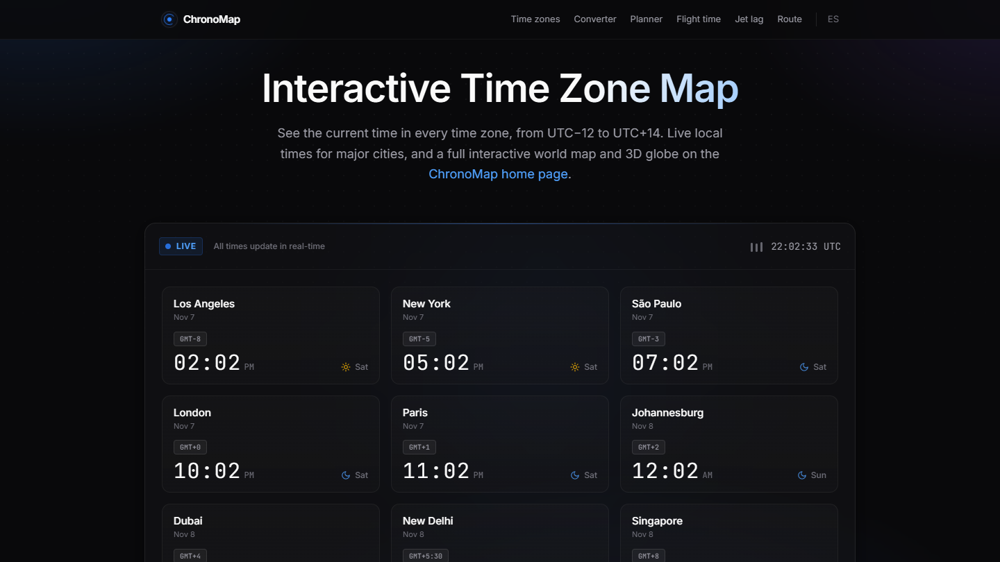

<div align="center">

<a href="https://www.chronomap.top"></a>

# ChronoMap

**The world clock you actually want to look at.**
A free, open-source world clock, time zone map and toolkit: 2D map and 3D globe, meeting planner, time zone converter, flight tools and a Discord timestamp generator. No account, no ads, everything runs in your browser.

[](https://www.chronomap.top)
[](https://apps.microsoft.com/detail/9pbr7jfs1mx0)
[](LICENSE)
[](CONTRIBUTING.md)

<a href="https://www.chronomap.top"></a>

[**Open ChronoMap →**](https://www.chronomap.top) · [Español](#-en-español) · [Contribute](#-contributing)

</div>

---

## ✨ What you can do

| Tool | What it does |
|---|---|
| 🌍 **[World clock map](https://www.chronomap.top/)** | Live local time on a 2D map or a draggable 3D globe. Hover a country, pin cities to compare them, and scrub forwards or backwards through time. |
| 🗺️ **[Time zone map](https://www.chronomap.top/time-zone-map)** | The current time in every UTC offset, from UTC−12 to UTC+14, with live clocks for major cities. |
| 🤝 **[Meeting planner](https://www.chronomap.top/meeting-planner)** | Add everyone's city and see working hours side by side. The overlap is highlighted and the plan can be shared with a link. |
| 🔁 **[Time zone converter](https://www.chronomap.top/time-zone-converter)** | Convert between abbreviations (EST, PST, GMT, IST, SGT…) or 200 cities, with daylight saving handled. |
| 💬 **[Discord timestamp generator](https://www.chronomap.top/discord-timestamp-generator)** | Turn any date into a `<t:UNIX:style>` code that shows up in each reader's own time zone, with a live preview of every format. |
| ✈️ **[Flight route map](https://www.chronomap.top/flight-route-map)** | Plot airports and layovers on a world map and see the local time at every stop. |
| 🕓 **[Flight time calculator](https://www.chronomap.top/flight-time-calculator)** | Arrival time and real duration across time zones. |
| 😴 **[Jet lag calculator](https://www.chronomap.top/jet-lag-calculator)** | Estimate recovery time and get tips for the trip. |
| ⏱️ **[Clock widget](https://www.chronomap.top/clock-widget)** | A free live clock you can embed on any website. |
| 🏙️ **[City pages](https://www.chronomap.top/time)** | Local time, UTC offset and daylight saving dates for 200 cities. |

Everything is available in **English and Spanish**, and there is a free **[Windows app](https://www.chronomap.top/windows)** on the Microsoft Store.

<table>
  <tr>
    <td width="50%"></td>
    <td width="50%"></td>
  </tr>
  <tr>
    <td width="50%"></td>
    <td width="50%"></td>
  </tr>
</table>

## 🧭 How it works

- **No backend for the time math.** Every conversion uses the browser's own IANA time zone database through `Intl` and `date-fns-tz`, so daylight saving changes are always correct.
- **Maps** are drawn with D3 and TopoJSON (`public/countries-110m.json`); city coordinates are resolved to time zones with `tz-lookup`.
- **Every tool is its own lightweight page** (a Vite multi-page build), and a static page for each city and common time zone conversion is generated at build time by `scripts/gen-city-pages.mjs`, with the live clock added as a small React island.
- **Privacy first.** No accounts and no ad trackers. The only analytics are Vercel's cookieless Web Analytics and Speed Insights. A strict Content Security Policy is set in `vercel.json`.

### Tech stack


## 🚀 Run it locally

You need **Node.js 22+**.

```bash
git clone https://github.com/agenciaRSE/chronomap.git
cd chronomap
npm install
npm run dev        # http://localhost:3000
```

| Command | What it does |
|---|---|
| `npm run dev` | Dev server with hot reload |
| `npm run build` | Type-check and production build into `dist/` |
| `npm test` | Unit tests (time zones, calendar, redirects, page content) |
| `npm run lint` | TypeScript check without emitting |

### Project map

```
App.tsx, index.tsx     main world-clock app (map, globe, scrubber, pinned cities)
components/            MapChart (2D/3D), TimeScrubber, LocationSearch, DiscordGenerator…
src/                   one entry per tool page + data (cities, zones, airports)
scripts/               static page generator for tools and city pages
es/                    Spanish versions of every page
api/                   small serverless function for the news ticker
test/                  node:test suites
```

## 🤝 Contributing

ChronoMap is a side project that grew into a full toolkit, and it gets better with every person who uses it. **If you like it, you're very welcome to help**, whether that's code, a translation, a bug report or just an idea.

Good places to start:

- 🌐 **Translations.** Today it speaks English and Spanish. Adding another language is a great first contribution.
- 🏙️ **Cities and airports.** Missing your city or a common layover? The data lives in `src/cities.json` and `src/airports.json`.
- 🐛 **Time zone edge cases.** Daylight saving transitions, half-hour and 45-minute offsets, unusual places: if something looks off, open an issue with the city and the time.
- ♿ **Accessibility and mobile.** Keyboard use, screen readers and touch on the 3D globe can always improve.
- 💡 **New tools.** Have an idea that fits a time zone toolkit? Open an issue to talk about it first.

Read **[CONTRIBUTING.md](CONTRIBUTING.md)** for the workflow. If ChronoMap saved you some mental math, a ⭐ on the repo helps other people find it.

## 🇪🇸 En español

ChronoMap es un reloj mundial y un conjunto de herramientas de husos horarios **gratis y de código abierto**: mapa 2D y globo 3D, planificador de reuniones, conversor, mapa de rutas de vuelo, calculadora de jet lag y generador de timestamps para Discord. Sin cuenta ni anuncios, todo funciona en tu navegador. Está en **[chronomap.top/es](https://www.chronomap.top/es/)**.

¿Te gusta? Las contribuciones son bienvenidas: traducciones, ciudades, errores con el horario de verano o ideas nuevas. Mira [CONTRIBUTING.md](CONTRIBUTING.md).

## 📄 License

[MIT](LICENSE) © Diego Meijide · Made by [AGENCIA RSE](https://agenciarse.com/en/studio/), a small WordPress and web studio from A Coruña, Spain.
